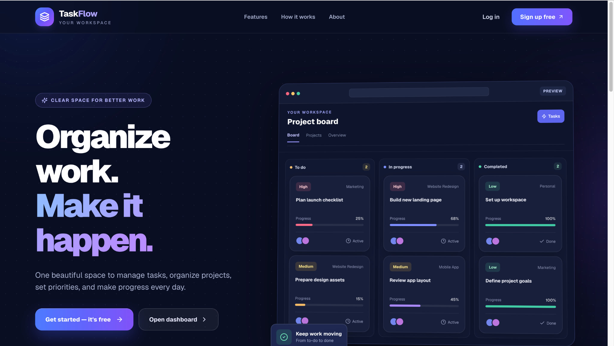
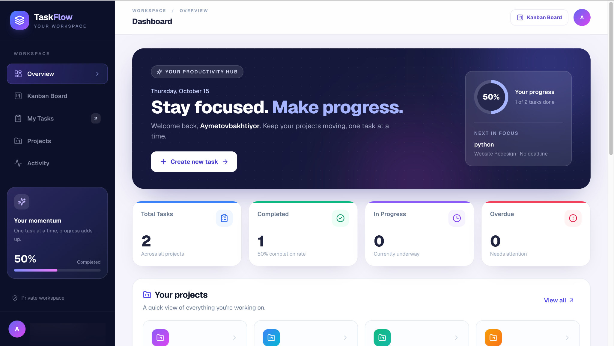
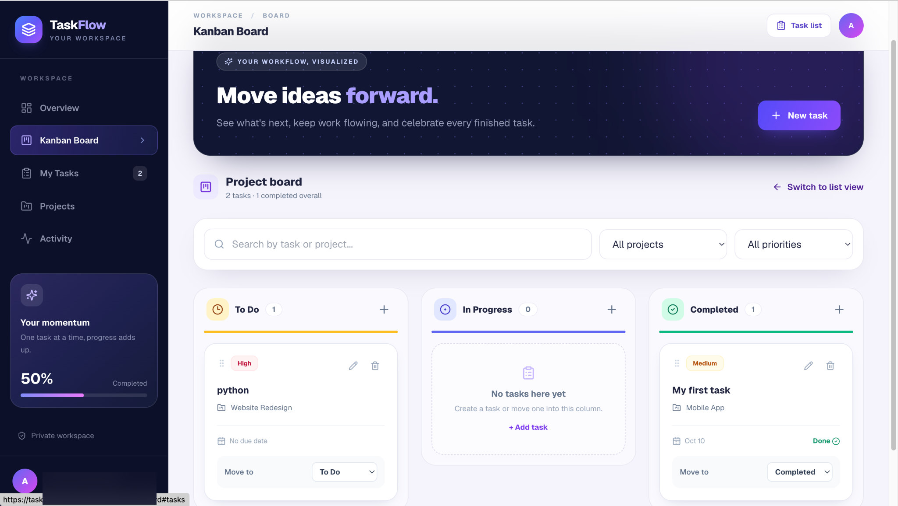
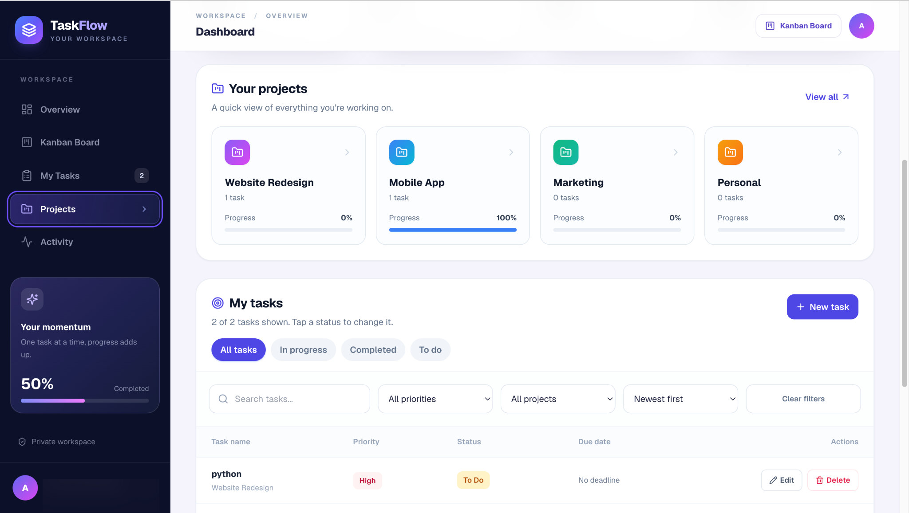
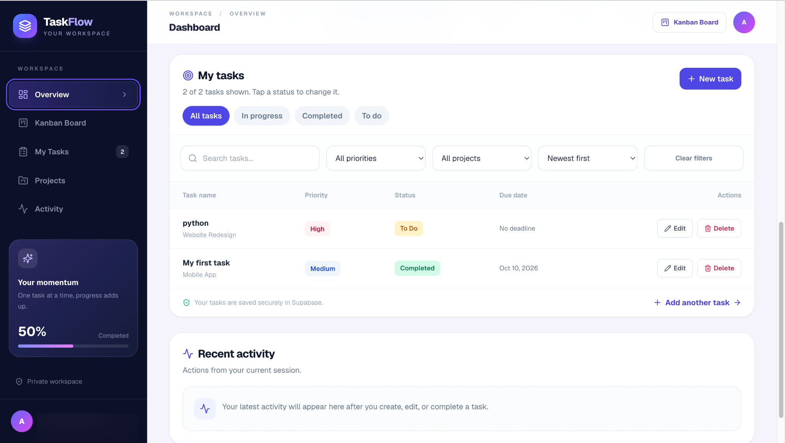
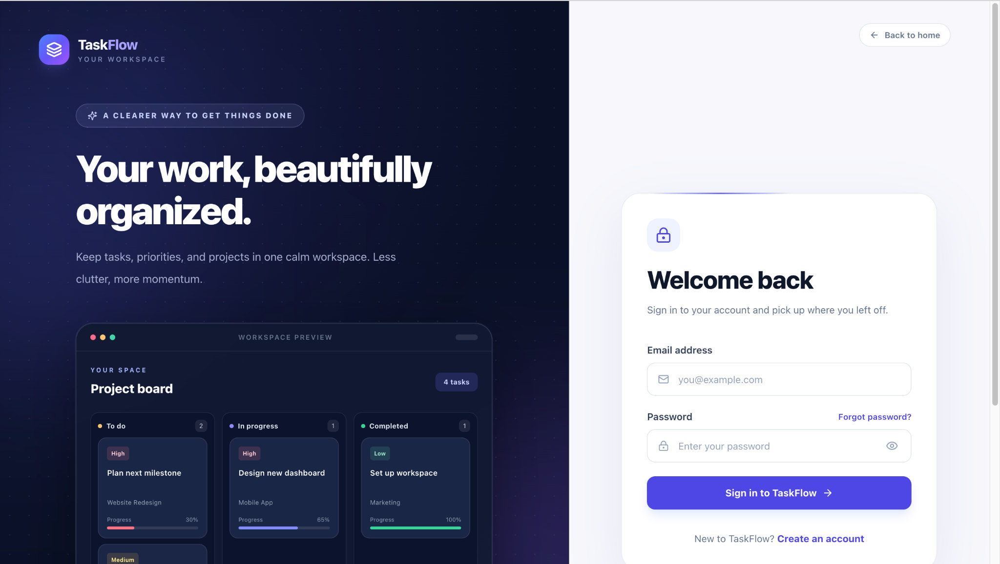
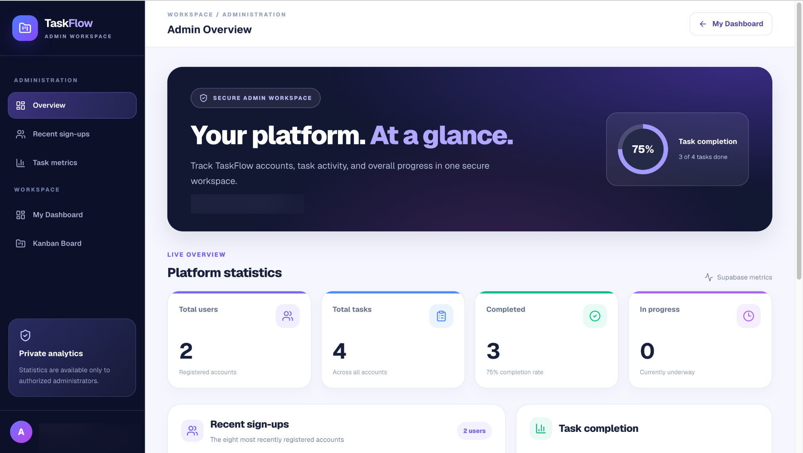

<div align="center">

# TaskFlow

### Organize work. Make it happen.

A responsive task and project management web application with a Kanban board, secure accounts, and a private admin dashboard.

**[Live Application](https://taskflow-bakhti.vercel.app/)** · **[Source Code](https://github.com/Bakhtiyor-dotcom/taskflow)** · **[Features](#features)** · **[Getting Started](#getting-started)**


</div>



## Overview

**TaskFlow** is a full-stack productivity application for organizing tasks across projects. Users can sign up, manage their private task lists, track progress, and move cards through a Kanban workflow. A separate, access-controlled admin area provides platform-wide metrics.

Built as a portfolio project with a focus on a polished UI, responsive layouts, and real data persistence through Supabase.

## Features

- **Account access:** email/password authentication, registration, and password recovery powered by Supabase Auth.
- **Task management:** create, update, delete, search, filter, and sort tasks.
- **Kanban board:** organize tasks across **To Do**, **In Progress**, and **Completed** columns, including drag-and-drop status updates and mobile-friendly status selection.
- **Project overview:** organize tasks within predefined projects and see project completion progress.
- **Priorities and deadlines:** assign Low, Medium, or High priority; track due dates and overdue tasks.
- **Personal dashboard:** see task counts, completion rate, project progress, and activity from the current session.
- **Private workspace:** user-specific task data protected by Supabase authentication and Row Level Security (RLS).
- **Admin analytics:** restricted `/admin` route with aggregate user/task metrics and recent registrations.
- **Responsive design:** desktop and mobile layouts with a consistent UI system.

## Screenshots

### Dashboard

A workspace overview with progress indicators, task statistics, and project summaries.



### Kanban Board

Move tasks between workflow stages and keep their status synchronized with Supabase.



### Projects & Task List

| Project progress | Task filters and actions |
|:---:|:---:|
|  |  |

### Authentication & Administration

| Login | Protected admin analytics |
|:---:|:---:|
|  |  |

*Email and account details in the screenshots have been obscured where appropriate for privacy. The landing-page board is an illustrative preview; authenticated task data is shown in the real dashboard and board.*

## Tech Stack

| Layer | Technology |
|---|---|
| Frontend | Next.js App Router, React, TypeScript |
| Styling | Tailwind CSS, CSS Modules, Lucide icons |
| Authentication | Supabase Auth with `@supabase/ssr` |
| Database | Supabase PostgreSQL with Row Level Security |
| Hosting | Vercel |

## Getting Started

### 1. Clone and install

```bash
git clone https://github.com/Bakhtiyor-dotcom/taskflow.git
cd taskflow
npm install
```

### 2. Configure Supabase

Create a [Supabase](https://supabase.com/) project and copy the example environment file:

```bash
cp .env.example .env.local
```

Edit `.env.local` with your own project settings:

```env
NEXT_PUBLIC_SUPABASE_URL=your-supabase-project-url
NEXT_PUBLIC_SUPABASE_PUBLISHABLE_KEY=your-publishable-key
```

> **Database setup:** this repository expects an existing Supabase schema for `public.tasks` with user-scoped RLS policies, plus `public.app_admins` for administrator access. The admin RPC is defined in [`supabase/admin_dashboard.sql`](supabase/admin_dashboard.sql), but the repo does not currently contain a complete one-command database migration. Configure the database before using task features. Never expose a Supabase service-role/secret key in client-side environment variables.

### 3. Run locally

```bash
npm run dev
```

Open [http://localhost:3000](http://localhost:3000).

### 4. Production check

```bash
npm run build
```

## Security Notes

- Private task queries are scoped to the signed-in user; database RLS enforces access boundaries.
- Admin access is verified server-side using the `app_admins` table.
- Aggregate administrator data comes from a database function that performs its own authorization check.
- Only public Supabase environment variables should be prefixed with `NEXT_PUBLIC_`.

## Project Background

TaskFlow was built by extending the [Next.js + Supabase starter](https://github.com/vercel/next.js/tree/canary/examples/with-supabase) with a custom task-management experience, a redesigned interface, Kanban workflows, user-scoped persistence, and a restricted administration area.

---

<div align="center">

**[View Live Demo](https://taskflow-bakhti.vercel.app/)** · **[Back to Top](#taskflow)**

</div>
